<p align="center">
  <picture>
    <source media="(prefers-color-scheme: dark)" srcset="assets/banner-dark.svg">
    
  </picture>
</p>

<p align="center">
  <a href="https://developer.nvidia.com/isaac/sim"></a>
  <a href="https://github.com/isaac-sim/IsaacLab"></a>
  <a href="https://github.com/facebookresearch/vjepa2"></a>
  
  
  <a href="LICENSE"></a>
</p>

<p align="center">
  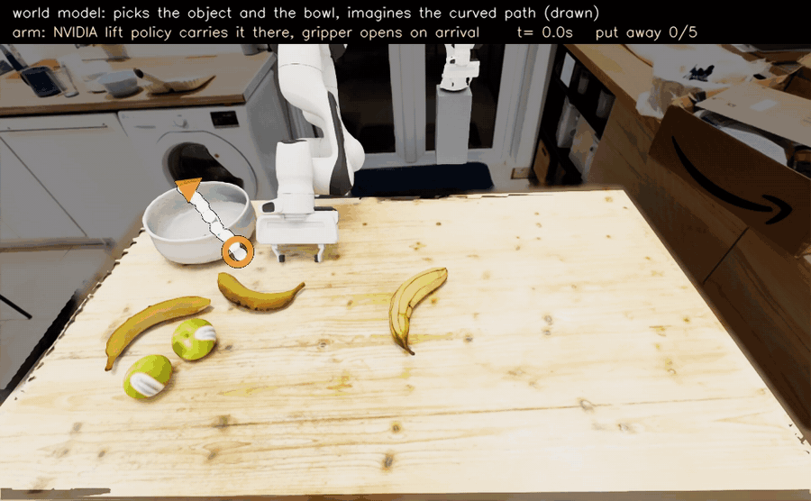
  <br><sub>One arm clearing a fruit table it has never seen: the world model chooses what to move, where it goes and the path to take (the dotted curve), and NVIDIA's lift policy does the grasp. No training, the only scripted part is opening the gripper over the bowl.</sub>
</p>

<p align="center">
  <picture>
    <source media="(prefers-color-scheme: dark)" srcset="assets/hero_strip-dark.jpg">
    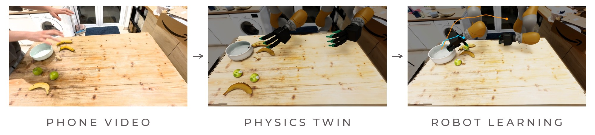
  </picture>
</p>

<p align="center"><b>An automated pipeline that turns unlabelled phone videos of a person doing a task into robot policies trained in simulation.</b></p>

<p align="center">My submission for the <b>Humanoid Robot Learning internship challenge</b>, October 2026.</p>

<p align="center"><b>Live write-up:</b> I keep updating this repo after the challenge deadline. If you are reading a cloned copy, the latest version is at <a href="https://ar3o.github.io/clean-tables/">ar3o.github.io/clean-tables</a>.</p>

## Why I built this

My idea for this project was to build something that would actually matter for the way physical AI companies are trying to train robots right now. In my own past projects I have worked with reinforcement learning and with LLM planning for robot arms, and the same problem kept coming up: every new task needs a person to build the scene, write and tune a reward, and babysit the training. It works, but it stops at one task, because the next task needs someone to do all of it again, and that just doesn't scale to the amount of data you need to train a generalist humanoid.

So I wanted to attempt something that I knew would be a lot harder, but more rewarding and with more open problems in it: a fully automated pipeline with no human labelling and no hand tuning per task. You put in egocentric videos of people doing things, which companies are now collecting in huge amounts, and you get out policies in simulation that can adapt to new configurations of that task. If that works, every new hour of human video becomes training data for robots without anyone writing task-specific code, and the cost of teaching a robot a new task drops to the cost of recording someone doing it.

I also picked a few harder options on purpose. The robot uses a four-finger Allegro hand instead of a parallel gripper, which would have been the classic choice for simplicity, because dexterous hands are what a generalist humanoid will actually have and I wanted to learn how to work with them. For the same reason I went for two arms working on the same table instead of one, which means the policy also has to learn to share the space. The scope is kept quite wide on purpose: the pipeline is designed to support any task that is about moving objects to where they belong, so sorting, tidying, packing and stacking all fit, while something like pulling a lever or turning a tap would probably not work and is out of scope.

I built this as my submission for the Humanoid Robot Learning internship challenge, starting at the beginning of October 2026, and I am carrying on with it after the deadline.

<p align="center">
  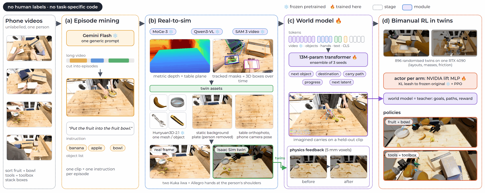
  <br><sub>The full pipeline. Nothing between the phone videos and the trained policy is labelled by hand or written for a specific task.</sub>
</p>

## 1. Recording human data

I recorded a number of videos of myself putting fruit and tools in semi-random setups across my table and then sorting them at a natural speed into containers, the fruit into a bowl and the tools into a toolbox, which are basic tasks within the scope. The tool demonstrations also have cardboard boxes and other clutter on the table, because I wanted to test whether this could work in a less structured setting, which is one of the biggest challenges for humanoids. I also recorded myself stacking boxes, which the world model learns from but the robot doesn't train on yet. In total that is 20 videos and 45 episodes: 14 fruit, 12 tools and 19 stacking.

I wanted the whole workflow to run without human labelling, and understanding what the tasks in a video even are needs some general knowledge about the world, so I used Gemini Flash, which has decent visual understanding, to mine the videos. It cuts long recordings into clips, so you can feed in long human videos without anyone pressing start and stop, and for each clip it returns a generic task instruction, the objects involved and where they ended up. I kept the prompt task agnostic, so it doesn't mention fruit, tools or anything else that would lead it, and it should work on any video you give it.

<p align="center">
  <picture>
    <source media="(prefers-color-scheme: dark)" srcset="assets/media/episodes-dark.gif">
    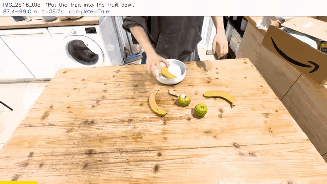
  </picture>
  <br><sub>Episodes cut and described automatically. The text at the top is Gemini's output.</sub>
</p>

## 2. From real video to simulation

The idea now is to recreate the real human data in simulation. That lets us expand a handful of demonstrations into many more examples of the task through domain randomisation, it gives an environment for massively parallel learning that would be far too expensive to collect in the real world, and it lets the world model learn about physics in a way you just can't get from monocular phone video. So I want to rebuild the same objects and the same environment in a simulator, and for this I use NVIDIA Isaac Sim, partly because I'm familiar with it and partly because it has a lot of what this needs: Isaac Lab for parallel RL, domain randomisation, realistic RTX rendering that will matter for closing the sim-to-real gap when training vision policies later, and of course everything runs on CUDA.

Because Gemini has already told us which objects matter in each clip, we can follow them through the video. MoGe-3 gives a metric depth map for every frame and I fit the table plane with RANSAC, which gives a table-centred frame for everything else. Qwen3-VL lists what is on the table, SAM 3 checks each name and keeps the ones it can actually find, and SAM 3's video tracking then follows every object and my hands through the episode, so the masks and the depth can be lifted to 3D boxes over time. My first version detected objects separately in each keyframe and linked them with matching, which kept inventing objects: whenever a box moved, a new "ghost" box appeared, and one stacking video ended up with 12 objects when there were really 7. SAM 3's video mode keeps one identity per object for the whole episode and fixed that.

<p align="center">
  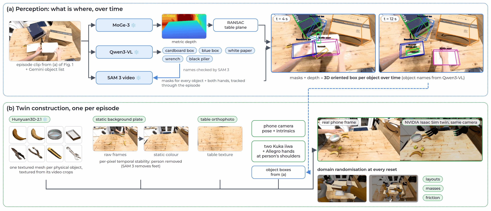
</p>

From the tracks, each episode becomes its own Isaac Sim scene of my actual table at the start of that episode. Most meshes come from Hunyuan3D-2.1 (the cardboard boxes are textured cuboids built straight from the video), made once per physical object from its video crops and reused across episodes, with the object's own crop projected on as texture where Hunyuan's texturing failed. Because my phone doesn't move during a recording, I didn't need Gaussian splatting for the background: for every pixel I keep the colour and depth that stay the same over the whole video, so anything that moves, including me, drops out, and SAM 3 removes whatever is left of me, like my feet when they stood still for a while. The twin's camera uses the phone's real pose and intrinsics so the render lines up with the video, and the two Kuka arms with Allegro hands are mounted roughly where my shoulders were. A twin takes about 11 seconds to build, so all 45 can be rebuilt whenever the builder changes. My first attempt used stand-in YCB objects and a made-up toolbox, which looked like a table with stuff on it but wasn't my table, so I threw it away.

<p align="center">
  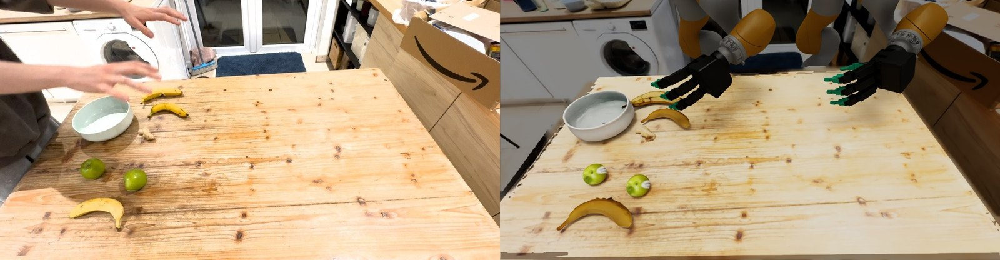
  <br><sub>A real start frame (left) and its twin rendered from the same camera (right).</sub>
</p>

## 3. The world model

The world model is the part I spent the most time on, because it is what replaces the person who would normally write the reward. It has to look at a scene and an instruction and say which object should move next, where it should end up, how it should get there and how far along the task is, and it has to learn all of that only from my videos.

<p align="center">
  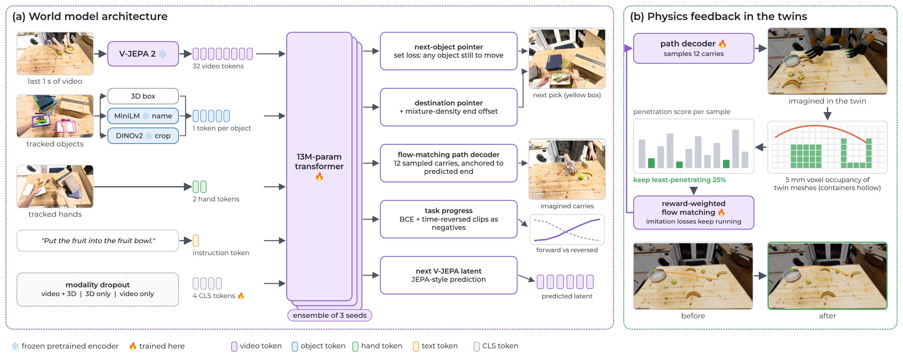
</p>

It is a 13M-parameter transformer that reads frozen V-JEPA 2 features from the last second of video, one token per object (its 3D box plus embeddings of its name and its appearance), my two hands and the instruction. One model covers all three tasks, and the instruction tells it which one it is doing. I trained it with modality dropout so it works from video and 3D together, from 3D alone or from video alone, which matters because in simulation the robot's teacher only gets exact 3D boxes and has no phone video to look at. Three copies trained with different seeds form an ensemble.

A few of the design choices came from things going wrong first. I don't tidy in a consistent order, so asking the model for the exact next object mostly taught it noise, and the next-object loss now accepts any object that still has to move. The end position is predicted relative to the destination it picks, so when the bowl is somewhere else in a randomised layout the goal moves with it. The imagined carries come from a flow-matching decoder anchored at the predicted end point, because my first version generated paths freely and they wandered all over the table. And task progress is trained on the number of moves done, with the same clips played backwards as negatives, because otherwise it just learns to read the clock from the video.

To evaluate it fairly, everything below is on held-out episodes using five folds, where each fold holds out three or four of the box videos completely (their tools and stacking episodes together) and two or three fruit episodes, and every number is compared with a simple baseline.

<p align="center">
  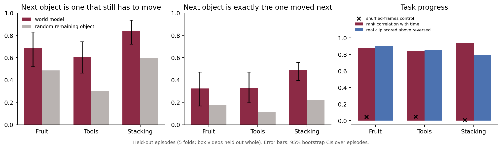
</p>

It picks an object that still needs moving well above chance on all three tasks, and progress is ordered correctly within an episode (rank correlation 0.85 to 0.94, against roughly zero for the same frames shuffled). When it sets goals in twins with random layouts it hasn't seen, the goal lands in the correct container for 99% of fruit and 88% of tools, with the misses being tools sent to a nearby cardboard box. There are two honest weaknesses. The progress value is squashed, rising from about 0.35 to 0.7 rather than 0 to 1 even on episodes it trained on, so it is underfit rather than failing to generalise; a monotone calibration fitted on the training folds recovers part of the range and is the green line in the video below. The imagined paths learned from video alone are also not accurate carries, which is what section 4 fixes.

<p align="center">
  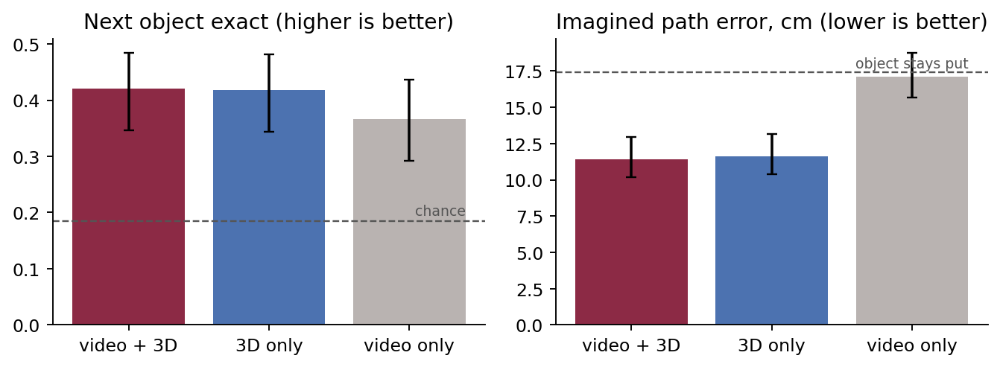
  <br><sub>Which input matters. The 3D object tokens carry the choice of object and the paths, and the video features carry most of the progress signal, which is why the robot's teacher can run on 3D alone.</sub>
</p>

Here it is on a fruit episode it never trained on. At the start it imagines a carry for every object on the table, each in its own colour, and then the real video plays with my actual carries drawn as dots in the same colours, so you can compare them object by object. Objects the tracker never saw moving still get an imagined carry but no dots; the ginger in this episode is missing entirely, because it is small and close to the table's colour and was never detected, which also means the world model never got a training example of it being moved.

<p align="center">
  <picture>
    <source media="(prefers-color-scheme: dark)" srcset="assets/media/wm_plan_IMG_2516_t05-dark.gif">
    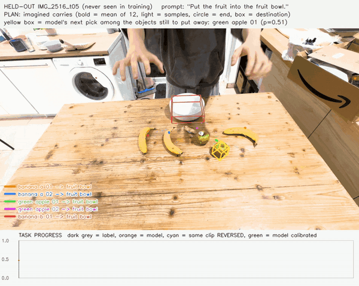
  </picture>
</p>

<details>
<summary>Same thing on a held-out tools episode</summary>
<br>
<p align="center">
  <picture>
    <source media="(prefers-color-scheme: dark)" srcset="assets/media/wm_plan_IMG_2542_t01-dark.gif">
    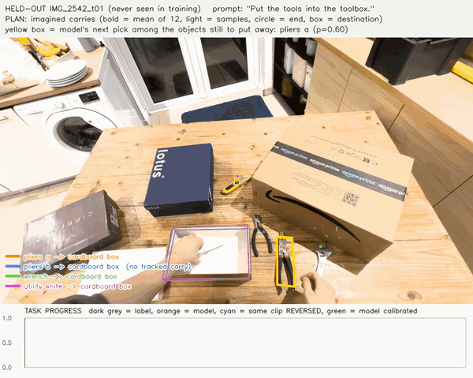
  </picture>
</p>
</details>

## 4. Teaching the world model some physics

Once I put the world model inside the twins, the problem with its paths was obvious: most of its imagined carries went straight through the side of the bowl or through a box. The carries it learned from barely lift off the table, because my hand covers the object for most of a carry and the tracker can't see what's under my fingers. I first tried fixing the data with FoundationPose for 6D object poses during carries, but it lost the object under my hand as well, so that went nowhere.

What worked was letting the world model check its own ideas against the twins. Every twin mesh is voxelised at 5 mm with containers kept hollow, so ending inside the bowl is fine and going through its rim is not. The world model then imagines lots of carries in lots of random layouts, each one is scored by how deep the moving object goes into anything else, and the path decoder is fine-tuned towards its own least-penetrating quarter of samples, which is basically reward-weighted regression applied to flow matching. The normal training on my videos keeps running at the same time so it doesn't forget where things go.

<p align="center">
  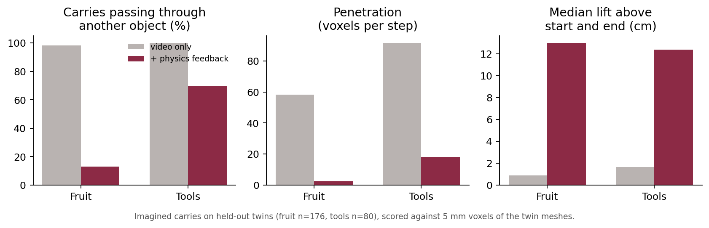
</p>

<p align="center">
  <picture>
    <source media="(prefers-color-scheme: dark)" srcset="assets/media/physics_feedback-dark.gif">
    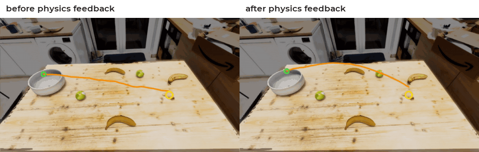
  </picture>
  <br><sub>The world model alone in a twin, moving each object along its own imagined path, before and after physics feedback. There is no robot here.</sub>
</p>

One thing I learned the hard way: I ran a third round of physics feedback on tools only, and it ended up carrying everything 65 to 75 cm into the air, which no arm should do. I only caught it by watching the paths in the twins, so the robot learns from the second round, and watching the imagined paths is now the first thing I check on any new world model.

## 5. Training robot arms with the world model as teacher

For the robot I didn't want to train grasping from scratch, because that would eat all my compute on a problem that is already reasonably solved, so each arm starts as a copy of NVIDIA's Isaac Lab policy for lifting objects, and everything the arm additionally needs to know (where the other arm is, the nearest obstacles and a few points along the world model's imagined path) comes in through zero-initialised layers, the same trick ControlNet uses, so on the first iteration the policy is exactly NVIDIA's and RL only has to learn what to change. A learned attention pointer decides which arm takes which object, with no rule like "left arm for the left half of the table", and one critic sees both arms.

During training the world model takes the place of a hand-written reward. At every reset it decides where each object should end up and how it should get there, the arm's goal slides along that imagined path, and the reward is progress along the path plus a bonus when the object is put down in the destination the world model chose, with small costs for the arms touching each other, knocking things over and taking too long. Training runs with PPO across about a thousand twins at once on one RTX 4090, rotating through 19 training twins with randomised layouts, masses and friction, while 7 twins from other episodes are held out for evaluation.

<p align="center">
  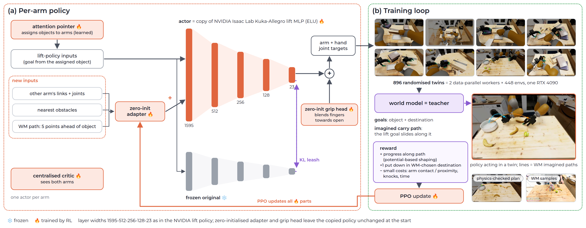
</p>

Most of the time this took was not RL at all but fixing the setup around it. The path reward used to reset every time an arm moved on to its next object, so finishing an object cost more than it paid, and the world model was getting the robot's palms as input, which sent some tool goals outside the toolbox, and success first meant landing within 5 cm of one exact point, which rejected most of the fruit that was really in the bowl. I fixed those one by one and the details are in [docs/method.md](docs/method.md).

### Four-finger hands, my best result

I started with the Kuka arm and the four-finger Allegro hand because that is the kind of hand a humanoid will have, and it is also the hardest thing to learn to grasp with. To test the policy fairly I held out twins built from episodes it never trained on and ran 128 episodes on each, starting both controllers from exactly the same randomised layouts. The baseline is NVIDIA's lift policy on both arms, with a greedy rule that sends each free arm to the nearest object and a hand-written rule that opens the hand over the container, so the comparison shows what the world-model-taught training adds. An object counts as done if it is inside its labelled container at the end of the episode.

| Six held-out twins, 128 episodes each | Objects in their container |
|:--|:-:|
| NVIDIA's lift policy + greedy + scripted release | 623 of 3,328, 18.7% [17.4, 20.1] |
| Two arms trained with the world model, scripted release | 855 of 3,328, 25.7% [24.2, 27.2] |
| Same, with the hand opening learned by the policy | **840 of 3,328, 25.2%** [23.8, 26.7] |

<p align="center">
  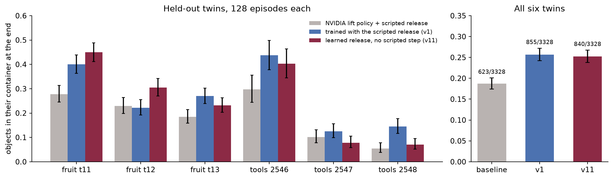
</p>

Training with the world model puts away about a third more objects than NVIDIA's policy with the same hand-written release, and the policy that decides by itself when to open its hand does as well as the one that was given the rule. It is fair to say that the second one learned from the rule, because its opening was first copied from it for 100 iterations before the rule was switched off for good. It is also better at some twins than others, doing well on fruit and on one of the three tool twins and worse on the other two, where the tools lie flat next to boxes.

<table>
<tr>
<td width="50%">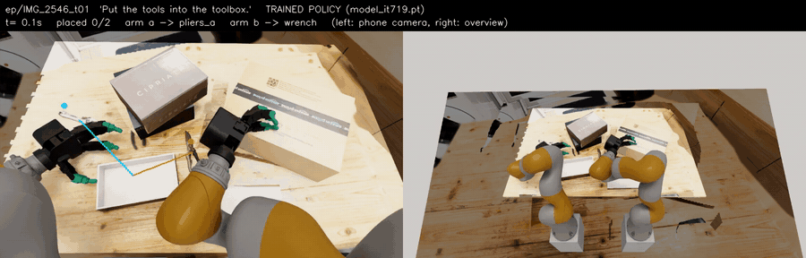</td>
<td width="50%">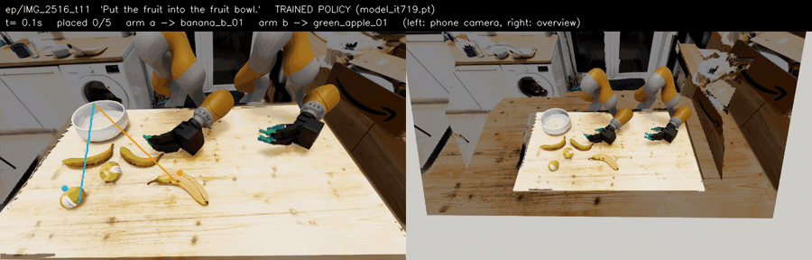</td>
</tr>
<tr>
<td><sub>Held-out tools twin, one episode at double speed: both tools go in and the table is done after 22.5 s.</sub></td>
<td><sub>Held-out fruit twin: three of five fruit go in, one banana is knocked off, and the hands end up crowding the bowl.</sub></td>
</tr>
</table>

The thing that held this back most was letting go. NVIDIA's policy was only ever trained to lift and hold, so it never opens its hand, and opening anywhere but right above the container loses reward, which makes holding on a comfortable place to stay. Every run where I removed the hand-written release and started from NVIDIA's policy alone stayed there. A run that starts 30% of its episodes from states it saved itself, holding an object near where the world model wants it, did learn to beat the scripted baseline on one tool twin but then flattened out. The earlier one-arm runs and the first two-arm numbers are in [docs/results.md](docs/results.md).

### Parallel grippers: the version that works

Because the hand was the bottleneck, I also tried an ordinary parallel-gripper arm, the Franka Panda, which comes with its own NVIDIA lift policy (96.9% on its cube task, with my observation matching the task's to 2e-7). This is the version where everything came together, and what I like about it is how little I had to write. NVIDIA's policy only knows how to reach a cube and lift it to a point in the air, so everything else comes from the world model: it decides which object to move next and which container it goes in (fruit to the bowl, tools to the toolbox), and it imagines the path the object should take. The arm then carries the object along the world model's imagined path to the container it chose, with NVIDIA's policy doing the grasp and the lift, and nothing is trained on my side. The one thing I script is the last step, opening the gripper when the object has arrived over the container, because NVIDIA's policy has never had a reason to open its hand. Two bookkeeping rules sit on top, because the world model keeps naming the object it has just been asked about: an object that has been let go of is not picked up again, and an object the arm cannot lift within ten seconds is given up on, so the arm moves on to the next one instead of waiting forever.

<p align="center">
  
  <br><sub>A held-out fruit twin, one arm, no learning, in real time. The dotted curve is the path the world model imagines for the object being moved and the arrow is where it ends, and the arm follows it. This is the cleanest of eight episodes I recorded this way (they put away 3, 4, 3, 5, 2, 2, 1 and 3 of 5), and the table below has the average over 96 episodes.</sub>
</p>

<p align="center">
  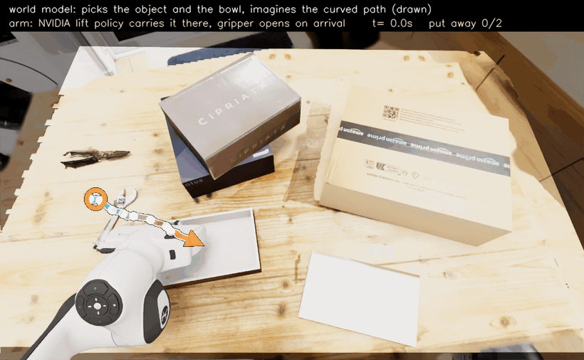
  <br><sub>The same on a held-out tools twin, following the imagined curve (both tools in the toolbox in this episode; the four episodes I recorded put away 0, 2, 2 and 1 of 2).</sub>
</p>

The table is the average over 96 episodes of 30 seconds on each of four held-out twins, which the world model and the policy never saw, counting an object as put away when the physics judge sees it resting inside its container.

| Held-out twin | Following the imagined curve | Straight arc to the same container |
|:--|:-:|:-:|
| Fruit, twin 11 | 293 of 480 (61%) | 338 of 480 (70%) |
| Fruit, twin 14 | 352 of 576 (61%) | 407 of 576 (71%) |
| Tools, twin 2546 | 111 of 192 (58%) | 104 of 192 (54%) |
| Tools, twin 2547 | 159 of 384 (41%) | 153 of 384 (40%) |
| All four | 915 of 1,632 (56%) | 1,002 of 1,632 (61%) |

The fruit is easier than the tools, since a flat wrench next to a toolbox is hard for a policy that was trained on cubes, and the gripper opening is scripted, so this is a showcase of what the world model contributes and not a learned result. Following the curve is a little worse than a straight arc on the fruit and the same on the tools, and getting it to work took one fix: the curve starts at table height, NVIDIA's policy only lifts towards a goal in the air, and with the raw curve it put away only 28% because it barely lifted, so I keep the first part of the curve at least 12 cm above the straight line. Even so, about 8% of the fruit is never grasped (mostly flat bananas) and a fifth is let go over the bowl and bounces out, which is what learning on top should be able to fix. Two arms with the same ingredients put away 29% of the objects on seven held-out twins in my first try, because they kept getting in each other's way, so the single arm is where I stopped.

## 6. From the trained policy to a vision-language-action model

Everything so far uses exact object positions from the simulator, which a real robot doesn't have, so the last step is to train a vision-language-action model that works from a camera and an instruction, with the RL policy as its teacher. I ran the strongest two-arm policy on the training twins and recorded every episode at 30 Hz (both arms' joints and commands, object poses, which arm was working on which object), which gave 3,648 episodes and 30 hours of robot data. Most episodes only finish part of the table, so the converter keeps every stretch that ends in a successful placement, which keeps 91% of the placements. Those first recordings have no images, so I added recording from my phone's viewpoint at 15 Hz to the same recorder, and it turned out that in runs with many twins in parallel only the first camera actually rendered anything, so the images are recorded one twin per process and there are only 105 usable segments.

The student is SmolVLA, a small open vision-language-action model, with its action head widened from 32 to 46 joints. I trained it for 15,000 steps and it does not work yet: the arms move smoothly and the hands go to the fruit, but the fingers close without grasping and it put away 0 of 5 fruit, while the teacher's own commands through the same conversion put away 2 of 5, so the plumbing is fine and the model is the problem. Its loss on held-out twins rose from 1.21 to 2.06 while the training loss kept falling, which is overfitting: 105 segments is far too little for a model this size. It needs several hundred image episodes from a better teacher, which is what the Franka run is for.

## Limitations and what's next

The biggest limitation right now is the two arms getting in each other's way: they often pick objects whose carries cross and end up stuck on each other, and flat tools next to boxes are still mostly missed. The best Allegro policy learned its release from a hand-written rule, the parallel-gripper version works without any training but its release is scripted and and the vision-language-action model I trained overfits its 105 segments and doesn't grasp, so the claim that this runs end to end from phone videos to a camera-based policy is still one step short. The world model's instruction embedding at training time didn't match the one the twins give the teacher, which explains some of the wrong tool goals, and retraining with one embedding is the fix. The first thing I want to try is learning on top of this controller, with the curve fix and without the scripted release, so the arm has to learn when to open. One idea I want to try for letting go is to have the world model learn from my videos when my own hand opens, so that it can say when to release and that signal can replace the container rule in the reward, and after that I want to record several hundred image episodes from a better teacher and retrain the vision-language-action model with image augmentation and early stopping, add videos of mixed tables so the instruction actually has to decide what to move, and feed in the full-table clean-ups I have already recorded. I will keep posting progress on the [project page](https://ar3o.github.io/clean-tables/). The full result tables and settings are in [docs/results.md](docs/results.md) and [docs/method.md](docs/method.md).

## Running it

Setup is in [docs/installation.md](docs/installation.md) and every stage is explained in [docs/running.md](docs/running.md).

```bash
export PYTHONPATH=$PWD
$VISION_PY -m cleantables.episodes.segment && $VISION_PY -m cleantables.episodes.prepare   # videos -> episodes
VISION_PY=$VISION_PY bash scripts/run_perception.sh                                       # episodes -> 3D tracks
bash scripts/build_twins.sh                                                              # -> one physics twin per episode
PY=$VISION_PY bash scripts/worldmodel.sh                                                 # -> world model + physics feedback
$SIM_PY -m cleantables.rl.train --run main                                               # -> two-arm policy
$SIM_PY -m cleantables.rl.evaluate --checkpoint runs/rl/main/ckpt/last.pt --scene IMG_2546_t01
```

```
cleantables/
  episodes/     cutting videos into episodes with Gemini
  perception/   depth, table frame, objects, SAM 3 tracking, 3D boxes, events, V-JEPA 2 features
  twin/         background plates, mesh library, Isaac Sim scenes, renders, world-model replay
  worldmodel/   dataset, model, training, evaluation, physics feedback, the teacher used by the robot
  rl/           two-arm environment, policy, PPO, training launcher, evaluation
configs/        one YAML per stage, defaults = the settings behind the results
scripts/        shell drivers for the longer stages
docker/         container definitions for the simulation and vision environments
```

<details markdown="1">
<summary>Ideas borrowed from other work</summary>

| Idea | Where it's from | Used for |
|:--|:--|:--|
| Self-supervised video features | V-JEPA 2 (Assran et al., 2025) | world-model video input and next-latent target |
| Flow matching | Lipman et al., 2023 | imagined carry paths |
| Mixture density networks | Bishop, 1994 | end-position distribution |
| Time-reversed negatives for progress | Arrow of time (Wei et al., 2018); Rank2Reward (Yang et al., 2024) | task-progress head |
| Modality dropout | ModDrop (Neverova et al., 2015) | running the world model on 3D alone |
| Deep ensembles | Lakshminarayanan et al., 2017 | three-seed ensemble |
| Reward-weighted regression | Peters & Schaal, 2007 | physics feedback |
| Zero-initialised input layers | ControlNet (Zhang et al., 2023) | adding inputs to NVIDIA's policy |
| KL penalty to a reference policy | RLHF fine-tuning (Ouyang et al., 2022) | keeping the grasp while fine-tuning |
| Each hand observes the other | Bi-DexHands (Chen et al., 2022) | two-arm coordination |
| Centralised critic | MAPPO (Yu et al., 2022) | one critic for both arms |
| Pointer attention | Pointer Networks (Vinyals et al., 2015) | assigning objects to arms |
| Potential-based shaping | Ng et al., 1999 | path-progress reward |
| Domain randomisation | Tobin et al., 2017 | layouts, masses, friction |
| Returning to promising states | Go-Explore (Ecoffet et al., 2021); reverse curriculum (Florensa et al., 2017) | learning to let go without a script |
| Vision-language-action model | SmolVLA (Shukor et al., 2025) | the camera-based student |

</details>

## Built with

| Component | Used for |
|:--|:--|
| Isaac Sim 6.1 and Isaac Lab 3 (NVIDIA) | twins, physics, rendering, RL environments |
| `Isaac-Lift-KukaAllegro` policy (NVIDIA) | starting weights for each arm |
| V-JEPA 2, SAM 3, DINOv2 (Meta) | video features, masks and tracking, appearance |
| MoGe-3 (Microsoft) | metric depth |
| Qwen3-VL (Alibaba), Gemini Flash (Google) | object listing, episode mining |
| Hunyuan3D-2.1 (Tencent) | object meshes |
| MiniLM | name and instruction embeddings |

## License

The code in this repository is MIT licensed. Third-party models and assets keep their own licences.
